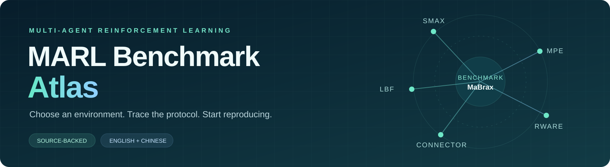
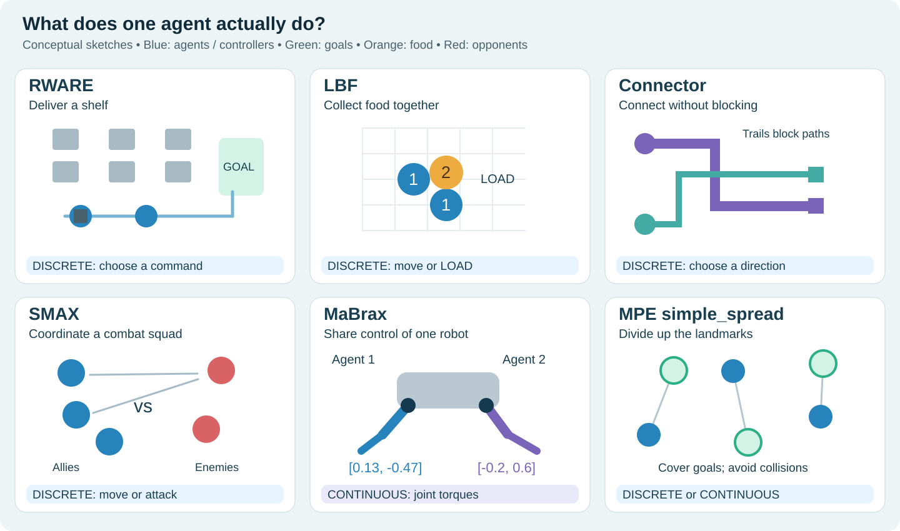

<p align="center">
  
</p>

<h1 align="center">多智能体强化学习环境与基准指南</h1>

<p align="center">
  选环境 · 找论文配置 · 查版本差异 · 从最小示例开始<br />
  <a href="README.md">English</a> ·
  <a href="docs/environment-index.md">环境总表</a> ·
  <a href="docs/paper-index.md">论文索引</a> ·
  <a href="docs/sable-guide.zh-CN.md">Sable 环境详解</a>
</p>

**这个仓库帮助你回答三个问题：我的研究适合什么环境？论文具体用了哪个版本？怎样开始一个可比较的实验？**

首版以 Sable 的六类环境为入口，收录 **18 条环境／数据资源记录、16 篇论文卡片，以及 Sable 的 45 个主实验任务**。每条内容都有来源或明确的待核查标记。

这里区分三类对象：在线交互环境、论文自定义任务、固定轨迹的离线数据。它们不能统一当作“数据集”来比较。

## 快速导航

| 你现在想做什么 | 对应入口 |
| --- | --- |
| 先理解每个环境是什么 | [图解与直观介绍](docs/environment-overview.zh-CN.md) |
| 判断某个算法能不能用 | [动作空间与算法适配](docs/algorithm-fit.zh-CN.md) |
| 根据研究问题选环境 | [中文选型指南](docs/selection-guide.zh-CN.md) |
| 浏览环境、动作空间和实现 | [环境与数据资源总表](docs/environment-index.md) |
| 查看一篇论文用了什么环境 | [论文—环境—训练方式索引](docs/paper-index.md) |
| 看懂 Sable 的环境和任务名 | [中文详解](docs/sable-guide.zh-CN.md) / [45 个任务完整表](docs/sable-tasks.md) |
| 先跑一个小例子 | [MPE2 / LBF / SMACv2 示例](examples/README.md) |
| 确认哪些已经实际运行 | [验证记录](docs/verification.md) |
| 避免做出无法比较的结果 | [版本与协议差异](docs/comparability.md) |

## 先看懂：这些环境都在玩什么



| 环境 | 智能体是谁、要做什么 | 每一步的动作 | 候选算法举例 |
| --- | --- | --- | --- |
| RWARE | 仓库机器人把货架送到配送口 | 离散：前进、转向、装卸等 5 个命令 | MAPPO、HAPPO、合作目标下的 QMIX |
| LBF | 采集者合作搬起单人搬不动的食物 | 离散：移动、停止、LOAD，共 6 个命令 | MAPPO、HAPPO、QMIX、HARL 离散 HASAC |
| Connector | 每个人画一条起点到终点的线，不能挡住别人 | 离散：上下左右、停止 | MAPPO、HAPPO、合作目标下的 QMIX |
| SMAX | 己方战斗单位配合击败敌军 | 离散：移动、停止、攻击某个目标 | MAPPO、HAPPO、QMIX |
| MaBrax | 各智能体控制同一机器人的不同关节 | 连续：输出关节力矩向量 | 连续 MAPPO、HAPPO、HASAC、MADDPG |
| MPE simple_spread | 小圆点分工覆盖地标并避碰 | 可离散或连续；Sable 采用连续版 | 先定动作版本，再筛选算法 |

这里列的是接口候选，不是性能排名。**观测是数字，不等于动作连续；奖励稀疏，不等于只能用某类算法。**

筛选顺序：**动作类型 → 观测／记忆 → 合作目标与奖励 → 训练／执行信息 → 在线或离线数据 → 预算。** [查看具体匹配规则](docs/algorithm-fit.zh-CN.md)。

Sable 主实验任务数为 RWARE 15、LBF 7、Connector 4、SMAX 11、MaBrax 5、MPE 3，共 45。完整标签见[任务表](docs/sable-tasks.md)。NEOM 与大规模 LBF 是额外扩展实验。

## 几个会直接影响结论的细节

1. **SMAX ≠ SMAC ≠ SMACv2。** Sable 任务名中的 `smacv2 ... units` 仍然属于 SMAX，不能和 SC2 引擎上的 SMACv2 混为一谈。
2. **同名环境可能有不同的碰撞与结束规则。** Sable 明确描述其 Jumanji RWARE 在碰撞时结束 episode，原版 RWARE 的处理不同。
3. **MPE 动作空间不能靠名字猜。** Sable 用连续动作；本仓库的入门例子采用 MPE2，可分别选择离散和连续动作，接口与 Sable 配置并不等价。
4. **MaBrax 与 MA-MuJoCo 的物理引擎不同。** 机器人关节划分相同，也不能直接沿用参考分数。
5. **策略熵不是协作多样性的充分指标。** 多样性研究还需行为、角色、覆盖或 SND 等与问题对应的指标。

## 无需安装训练框架即可查询

Python 3.10+，查询工具仅使用标准库：

```bash
git clone https://github.com/Dengyu-Z/marl-benchmark-atlas.git
cd marl-benchmark-atlas
python scripts/atlas.py --paper sable
python scripts/atlas.py --tag sparse-reward --action discrete
python scripts/atlas.py --kind offline-dataset --json
python scripts/atlas.py --algorithm qmix --action discrete --explain
python scripts/validate_catalog.py
```

`--paper sable` 会列出 Sable 关联的全部资源，包括额外的 NEOM；只看主实验的 45 个任务请使用 [任务表](docs/sable-tasks.md)。JSON 与 CSV 可直接用于你自己的筛选工具。

## 跑通第一个环境

```bash
python -m venv .venv
source .venv/bin/activate
# Windows PowerShell 请将上一行替换为：.\.venv\Scripts\Activate.ps1
python -m pip install -r requirements/smoke.txt
python examples/mpe_smoke.py --output runs/mpe.json
python examples/mpe_smoke.py --continuous --output runs/mpe-continuous.json
python examples/lbf_smoke.py --output runs/lbf.json
```

首版已实际验证 **MPE2 离散动作、MPE2 连续动作、原版 LBF**，每种配置使用随机策略运行 2 个 episode。记录包含版本和配置，见[验证页](docs/verification.md)。SMACv2 提供待验证示例，需要额外安装 SC2 与地图。

**随机动作能运行，只说明接口可用。** 它不代表算法复现成功，也不代表得到了论文中的回报。本仓库没有虚构训练曲线、性能提升或硬件耗时。

## 按什么标准持续维护

- 文献核对：提供原文节号、表号或页码。
- 接口验证：提供 reset/step 运行记录、版本和配置。
- 基线复现：还需完整训练日志、预算、独立训练种子与统计结果。

欢迎补充环境卡片、论文配置、安装经验和运行记录。请从 [贡献指南](CONTRIBUTING.md) 和 [路线图](ROADMAP.md) 开始。原始整理和工具代码采用 [MIT](LICENSE) 协议；论文、第三方代码与数据遵循各自协议。
